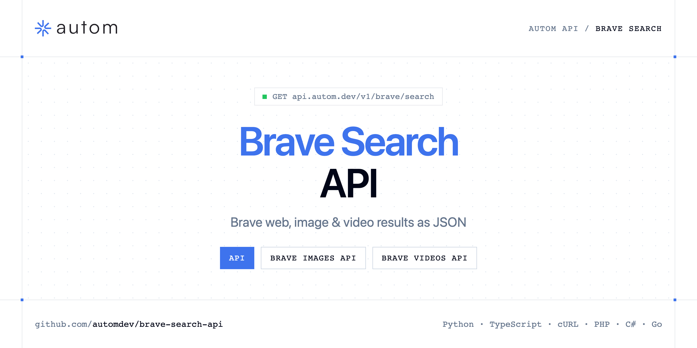

<p align="center">
  <a href="https://www.autom.dev"></a>
</p>

# Brave Search API

[](https://discord.gg/CFj3ph8aHU) [](https://app.autom.dev/register) [](https://docs.autom.dev) [](LICENSE)

The **Autom Brave Search API** returns Brave web, image and video results as structured JSON.

- **Brave Search API** — Search Brave Search via API and retrieve structured organic results with pagination.
- **Brave Images API** — Search Brave Images via API and retrieve structured image results with pagination and SafeSearch.
- **Brave Videos API** — Search Brave Videos via API and retrieve structured video results with pagination and SafeSearch.

Use it for rank tracking on Brave, research or LLM grounding.

| Endpoint | Request | Credits |
|---|---|---|
| [Brave Search API](#brave-search-api) | `GET /v1/brave/search` | 1 |
| [Brave Images API](#brave-images-api) | `GET /v1/brave/images` | 1 |
| [Brave Videos API](#brave-videos-api) | `GET /v1/brave/videos` | 1 |

## Table of contents

- [How it works](#how-it-works)
- [Brave Search API](#brave-search-api)
- [Brave Images API](#brave-images-api)
- [Brave Videos API](#brave-videos-api)
- [Code examples in other languages](#code-examples-in-other-languages)
- [Use cases](#use-cases)
- [Why Autom?](#why-autom)
- [FAQ](#faq)
- [Official SDKs](#official-sdks)
- [Related repositories](#related-repositories)
- [Support](#support)

## How it works

1. **Create a Autom account** and copy your API key from the [dashboard](https://app.autom.dev/register).
2. **Call `https://api.autom.dev`** with the header `x-api-key: YOUR_API_KEY`.
3. **Use the result** in your app — no infrastructure to run.

```bash
export AUTOM_API_KEY="your-api-key"
pip install requests        # Python
# TypeScript: Node.js 18+ (native fetch), run with `npx tsx file.ts`
```

## Brave Search API

Search Brave Search via API and retrieve structured organic results with pagination.

`GET https://api.autom.dev/v1/brave/search` · **1 credit per request** · [API reference](https://app.autom.dev/openapi)

### Request parameters

| Parameter | In | Type | Required | Description |
|---|---|---|---|---|
| `query` | query | string | ✅ | The search query you want to run on Brave Search. |
| `page` | query | number | — | Page number for pagination. |
| `gl` | query | string | — | Country code, for example us, fr, gb, de. |
| `hl` | query | string | — | Language code, for example en, fr, de. |

### Python example

```python
import os

import requests

API_KEY = os.environ["AUTOM_API_KEY"]
HEADERS = {"x-api-key": API_KEY}

response = requests.get(
    "https://api.autom.dev/v1/brave/search",
    headers=HEADERS,
    params={
        "query": "growth hacking",
    },
    timeout=120,
)
response.raise_for_status()

data = response.json()
print(data)
```

### TypeScript example

```typescript
type BraveSearchApi = {
  organic_results?: {
    link?: string;
    title?: string;
    domain?: string;
    snippet?: string;
    position?: number;
  }[];
  search_parameters?: {
    q?: string;
    gl?: string;
    hl?: string;
    page?: number;
    engine?: string;
  };
};

const headers = { "x-api-key": process.env.AUTOM_API_KEY!, "Content-Type": "application/json" };

const params = new URLSearchParams({
  "query": "growth hacking",
});

const response = await fetch(`https://api.autom.dev/v1/brave/search?${params}`, { headers });
if (!response.ok) throw new Error(`HTTP ${response.status}: ${await response.text()}`);

const data = (await response.json()) as BraveSearchApi;
console.log(data);
```

### Output example

Example response from the API reference, abridged.

```json
{
  "organic_results": [
    {
      "link": "https://www.anthropic.com/",
      "title": "Anthropic",
      "domain": "www.anthropic.com",
      "snippet": "Anthropic is an AI safety company. Claude is its assistant.",
      "position": 1
    },
    {
      "link": "https://docs.anthropic.com/",
      "title": "Anthropic documentation",
      "domain": "docs.anthropic.com",
      "snippet": "Documentation for the Claude API and the Anthropic platform.",
      "position": 2
    }
  ],
  "search_parameters": {
    "q": "anthropic",
    "gl": "us",
    "hl": "en",
    "page": 1,
    "engine": "brave"
  }
}
```

### Response fields

| Field | Type | Description |
|---|---|---|
| `organic_results[]` | object[] |  |
| `organic_results[].link` | string |  |
| `organic_results[].title` | string |  |
| `organic_results[].domain` | string |  |
| `organic_results[].snippet` | string |  |
| `organic_results[].position` | integer |  |
| `search_parameters` | object |  |
| `search_parameters.q` | string |  |
| `search_parameters.gl` | string |  |
| `search_parameters.hl` | string |  |
| `search_parameters.page` | integer |  |
| `search_parameters.engine` | string |  |

## Brave Images API

Search Brave Images via API and retrieve structured image results with pagination and SafeSearch.

`GET https://api.autom.dev/v1/brave/images` · **1 credit per request** · [API reference](https://app.autom.dev/openapi)

### Request parameters

| Parameter | In | Type | Required | Description |
|---|---|---|---|---|
| `query` | query | string | ✅ | The search query you want to run on Brave Images. |
| `page` | query | number | — | Page number for pagination (50 results per page). |
| `gl` | query | string | — | Country code (e.g. fr, us). Mapped to Brave country. |
| `hl` | query | string | — | Language code (e.g. fr, en). Mapped to Brave lang. |
| `safe` | query | string | — | SafeSearch: active \| off \| moderate \| strict. Google-style active maps to Brave strict. |

### Python example

```python
import os

import requests

API_KEY = os.environ["AUTOM_API_KEY"]
HEADERS = {"x-api-key": API_KEY}

response = requests.get(
    "https://api.autom.dev/v1/brave/images",
    headers=HEADERS,
    params={
        "query": "newton laws",
    },
    timeout=120,
)
response.raise_for_status()

data = response.json()
print(data)
```

### TypeScript example

```typescript
type BraveImagesApi = {
  images?: {
    url?: string;
    link?: string;
    title?: string;
    domain?: string;
    source?: string;
    position?: number;
    thumbnail?: string;
    image_width?: number;
    image_height?: number;
  }[];
  search_parameters?: {
    q?: string;
    gl?: string;
    hl?: string;
    page?: number;
    safe?: string;
    engine?: string;
    safesearch?: string;
  };
};

const headers = { "x-api-key": process.env.AUTOM_API_KEY!, "Content-Type": "application/json" };

const params = new URLSearchParams({
  "query": "newton laws",
});

const response = await fetch(`https://api.autom.dev/v1/brave/images?${params}`, { headers });
if (!response.ok) throw new Error(`HTTP ${response.status}: ${await response.text()}`);

const data = (await response.json()) as BraveImagesApi;
console.log(data);
```

### Output example

Example response from the API reference, abridged.

```json
{
  "images": [
    {
      "url": "https://i.pinimg.com/originals/64/b2/43/64b24344ba1b61481e519a643ed926c8.jpg",
      "link": "https://www.pinterest.com/ideas/laws-of-motion-image/919633104944/",
      "title": "Newton's laws of motion",
      "domain": "www.pinterest.com",
      "source": "pinterest.com",
      "position": 1,
      "thumbnail": "https://imgs.search.brave.com/example/thumb.jpg",
      "image_width": 1100,
      "image_height": 850
    }
  ],
  "search_parameters": {
    "q": "newton laws",
    "gl": "fr",
    "hl": "fr",
    "page": 1,
    "safe": "active",
    "engine": "brave_images",
    "safesearch": "strict"
  }
}
```

### Response fields

| Field | Type | Description |
|---|---|---|
| `images[]` | object[] |  |
| `images[].url` | string |  |
| `images[].link` | string |  |
| `images[].title` | string |  |
| `images[].domain` | string |  |
| `images[].source` | string |  |
| `images[].position` | integer |  |
| `images[].thumbnail` | string |  |
| `images[].image_width` | integer |  |
| `images[].image_height` | integer |  |
| `search_parameters` | object |  |
| `search_parameters.q` | string |  |
| `search_parameters.gl` | string |  |
| `search_parameters.hl` | string |  |
| `search_parameters.page` | integer |  |
| `search_parameters.safe` | string |  |
| `search_parameters.engine` | string |  |
| `search_parameters.safesearch` | string |  |

## Brave Videos API

Search Brave Videos via API and retrieve structured video results with pagination and SafeSearch.

`GET https://api.autom.dev/v1/brave/videos` · **1 credit per request** · [API reference](https://app.autom.dev/openapi)

### Request parameters

| Parameter | In | Type | Required | Description |
|---|---|---|---|---|
| `query` | query | string | ✅ | The search query you want to run on Brave Videos. |
| `page` | query | number | — | Page number for pagination. |
| `gl` | query | string | — | Country code (e.g. fr, us). Mapped to Brave country. |
| `hl` | query | string | — | Language code (e.g. fr, en). Mapped to Brave lang. |
| `safe` | query | string | — | SafeSearch: active \| off \| moderate \| strict. Google-style active maps to Brave strict. |

### Python example

```python
import os

import requests

API_KEY = os.environ["AUTOM_API_KEY"]
HEADERS = {"x-api-key": API_KEY}

response = requests.get(
    "https://api.autom.dev/v1/brave/videos",
    headers=HEADERS,
    params={
        "query": "newton laws",
    },
    timeout=120,
)
response.raise_for_status()

data = response.json()
print(data)
```

### TypeScript example

```typescript
type BraveVideosApi = {
  organic_results?: {
    date?: string;
    link?: string;
    title?: string;
    domain?: string;
    source?: string;
    channel?: string;
    snippet?: string;
    duration?: string;
    position?: number;
    thumbnail?: string;
  }[];
  search_parameters?: {
    q?: string;
    gl?: string;
    hl?: string;
    page?: number;
    safe?: string;
    engine?: string;
    safesearch?: string;
  };
};

const headers = { "x-api-key": process.env.AUTOM_API_KEY!, "Content-Type": "application/json" };

const params = new URLSearchParams({
  "query": "newton laws",
});

const response = await fetch(`https://api.autom.dev/v1/brave/videos?${params}`, { headers });
if (!response.ok) throw new Error(`HTTP ${response.status}: ${await response.text()}`);

const data = (await response.json()) as BraveVideosApi;
console.log(data);
```

### Output example

Example response from the API reference, abridged.

```json
{
  "organic_results": [
    {
      "date": "18 septembre 2023",
      "link": "https://www.youtube.com/watch?v=85kGMxuts98",
      "title": "Newton's Laws of Motion | 4.1 General Physics",
      "domain": "www.youtube.com",
      "source": "YouTube",
      "channel": "Chad's Prep",
      "snippet": "Chad provides an introduction to Newton's Laws of Motion.",
      "duration": "14:16",
      "position": 1,
      "thumbnail": "https://imgs.search.brave.com/example/thumb.jpg"
    }
  ],
  "search_parameters": {
    "q": "newton laws",
    "gl": "fr",
    "hl": "fr",
    "page": 1,
    "safe": "active",
    "engine": "brave_videos",
    "safesearch": "strict"
  }
}
```

### Response fields

| Field | Type | Description |
|---|---|---|
| `organic_results[]` | object[] |  |
| `organic_results[].date` | string |  |
| `organic_results[].link` | string |  |
| `organic_results[].title` | string |  |
| `organic_results[].domain` | string |  |
| `organic_results[].source` | string |  |
| `organic_results[].channel` | string |  |
| `organic_results[].snippet` | string |  |
| `organic_results[].duration` | string |  |
| `organic_results[].position` | integer |  |
| `organic_results[].thumbnail` | string |  |
| `search_parameters` | object |  |
| `search_parameters.q` | string |  |
| `search_parameters.gl` | string |  |
| `search_parameters.hl` | string |  |
| `search_parameters.page` | integer |  |
| `search_parameters.safe` | string |  |
| `search_parameters.engine` | string |  |
| `search_parameters.safesearch` | string |  |

## Code examples in other languages

Ready-to-run examples live in [`examples/`](examples); each reads your key from `AUTOM_API_KEY`.

| Language | `brave-search` | `brave-images` | `brave-videos` |
|---|---|---|---|
| cURL (Bash) | [brave_search.sh](examples/curl/brave_search.sh) | [brave_images.sh](examples/curl/brave_images.sh) | [brave_videos.sh](examples/curl/brave_videos.sh) |
| PHP | [brave_search.php](examples/php/brave_search.php) | [brave_images.php](examples/php/brave_images.php) | [brave_videos.php](examples/php/brave_videos.php) |
| C# | [BraveSearch.cs](examples/csharp/BraveSearch.cs) | [BraveImages.cs](examples/csharp/BraveImages.cs) | [BraveVideos.cs](examples/csharp/BraveVideos.cs) |
| Go | [brave_search.go](examples/go/brave_search.go) | [brave_images.go](examples/go/brave_images.go) | [brave_videos.go](examples/go/brave_videos.go) |
| Java | [BraveSearchExample.java](examples/java/BraveSearchExample.java) | [BraveImagesExample.java](examples/java/BraveImagesExample.java) | [BraveVideosExample.java](examples/java/BraveVideosExample.java) |
| Ruby | [brave_search.rb](examples/ruby/brave_search.rb) | [brave_images.rb](examples/ruby/brave_images.rb) | [brave_videos.rb](examples/ruby/brave_videos.rb) |
| Node.js | [brave_search.mjs](examples/nodejs/brave_search.mjs) | [brave_images.mjs](examples/nodejs/brave_images.mjs) | [brave_videos.mjs](examples/nodejs/brave_videos.mjs) |

## Use cases

- **Rank tracking** — Track positions on Brave Search.
- **LLM grounding** — Feed agents with independent-index results.

## Why Autom?

- **Every SERP in one API** — Google Search, AI Mode, Maps, News, Shopping, Images, Videos, Jobs, Autocomplete, plus Bing and Brave.
- **Structured JSON** — documented fields instead of brittle HTML parsing.
- **Geo & language targeting** — search like a user from the country and language you need.
- **One API key, one header** — `x-api-key` on every request.
- **Copy-paste examples** — Python and TypeScript in each README, 7 more languages in `examples/`.

## FAQ

### How do I authenticate?

Create an account on [Autom](https://app.autom.dev/register), copy your API key and send it in the `x-api-key` header of every request to `https://api.autom.dev`.

### How much does a request cost?

Credits per call: `/v1/brave/search` **1**, `/v1/brave/images` **1**, `/v1/brave/videos` **1**. See [Autom pricing](https://www.autom.dev/pricing).

### Which languages are supported?

Any language that can make an HTTP request. This README shows Python and TypeScript; the [`examples/`](examples) folder contains cURL, PHP, C#, Go, Java, Ruby and Node.js.

## Official SDKs

Use Autom from your own language with a typed client:

| SDK | Package | Install |
| --- | --- | --- |
| Node.js | [`@automdev/sdk`](https://www.npmjs.com/package/@automdev/sdk) | `npm install @automdev/sdk` |
| Python | [`automdev`](https://pypi.org/project/automdev/) | `pip install automdev` |
| Go | [`autom-go`](https://pkg.go.dev/github.com/automdev/autom-go) | `go get github.com/automdev/autom-go` |
| .NET | [`Autom`](https://www.nuget.org/packages/Autom) | `dotnet add package Autom` |
| Ruby | [`autom`](https://rubygems.org/gems/autom) | `gem install autom` |
| PHP | [`autom/sdk`](https://packagist.org/packages/autom/sdk) | `composer require autom/sdk` |
| Java | [`autom-java`](https://github.com/automdev/autom-java) | build from source, see its README |
| CLI | [`@automdev/cli`](https://www.npmjs.com/package/@automdev/cli) | `npm install -g @automdev/cli` |
| MCP server | [`@automdev/mcp`](https://www.npmjs.com/package/@automdev/mcp) | `npx -y @automdev/mcp` |

## Related repositories

- [Google Search API](https://github.com/automdev/google-search-api)
- [Google AI Mode API](https://github.com/automdev/google-ai-mode-api)
- [Google Maps API](https://github.com/automdev/google-maps-api)
- [Google News API](https://github.com/automdev/google-news-api)
- [Google Shopping API](https://github.com/automdev/google-shopping-api)
- [Google Images API](https://github.com/automdev/google-images-api)
- [Google Videos API](https://github.com/automdev/google-videos-api)
- [Google Jobs API](https://github.com/automdev/google-jobs-api)
- [All Autom repositories](https://github.com/automdev)

## Support

- 💬 Join the [Discord](https://discord.gg/CFj3ph8aHU) to ask questions and share what you build.
- 📚 Read the [API reference](https://docs.autom.dev).
- 🔑 [Get your API key](https://app.autom.dev/register).

---

<p align="center">
  <a href="https://www.autom.dev">
    <picture>
      <source media="(prefers-color-scheme: dark)" srcset="images/logo-dark.svg">
      
    </picture>
  </a>
  <br>
  <sub>Built by <a href="https://www.autom.dev">Autom</a>. Examples are released under the MIT license.</sub>
</p>
